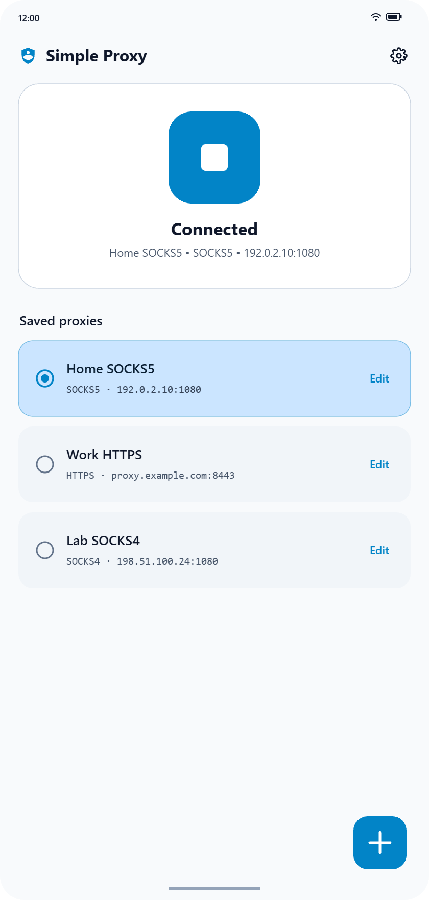
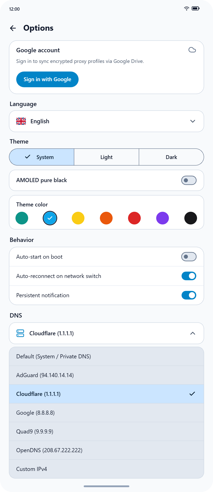
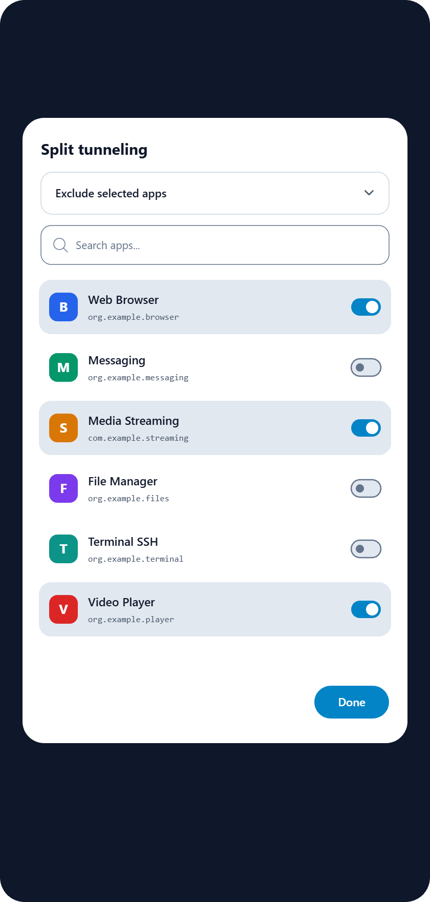
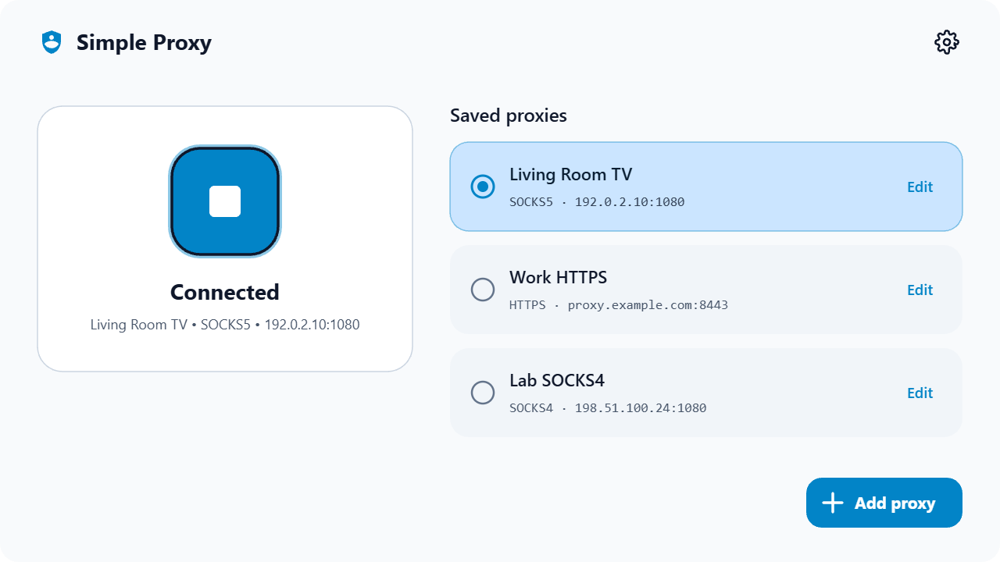

# Simple Proxy

> Lightweight proxy client for Android phones & Android TV

[](https://github.com/carleseee/SimpleProxy/actions/workflows/android-security.yml)
[](LICENSE)
[](https://developer.android.com)
[](https://kotlinlang.org)
[](https://m3.material.io)
[](https://ko-fi.com/carlese)

**Simple Proxy** is a high-performance, open-source Android VPN client built with Jetpack Compose. It allows you to route system-wide or per-app traffic through **SOCKS5**, **SOCKS4**, **HTTP**, or **HTTPS** proxies, offering zero-knowledge End-to-End Encrypted (E2EE) profile sync via Google Drive and Firebase.

---

## 📸 Screenshots

| Home (Connected) | Options & Full-Width DNS | Split Tunneling |
| :---: | :---: | :---: |
|  |  |  |

<p align="center">
  
</p>

---

## ✨ Features

- 🚀 **Full Proxy Protocol Support**: SOCKS5 (with TCP & UDP associate support), SOCKS4 / SOCKS4a, HTTP CONNECT, and HTTPS (TLS CONNECT).
- 🔐 **Zero-Knowledge E2EE Cloud Sync**: Multi-device synchronization. Proxy hostnames, ports, and credentials are encrypted on-device with AES-256-GCM. The master key is generated locally and stored safely in your personal Google Drive `appDataFolder`.
- 🔀 **Split Tunneling**: Exclude specific apps or proxy only selected ones, with All / User / System filters, system-app badges and Select all / Deselect all. "Include only selected" keeps all other traffic (including OS background traffic) off the proxy.
- 🌐 **Custom & Secure DNS Routing**: Integrated support for System DNS, AdGuard, Cloudflare (1.1.1.1), Google (8.8.8.8), Quad9, OpenDNS, or Custom IPv4 DNS servers with automatic DNS-over-TCP / DoH fallback.
- 📺 **Android TV & Leanback Ready**: Native D-Pad navigation, high-contrast focus rings, and TV banner support for Android TV devices and Set-Top Boxes.
- ⚡ **Quick Settings (QS) Tile**: Toggle VPN connection status directly from the Android Quick Settings shade.
- 🎨 **Material 3 Expressive UI**: Dynamic color accents, custom color palettes, AMOLED pure-black dark mode, and multi-language support (Italian, English, French, German, Spanish, Russian, Chinese, Japanese, Polish).
- 🔄 **Auto-Start & Auto-Reconnect**: Automatically start proxy connection on boot and seamlessly handle Wi-Fi / Cellular network switches.

---

## 🏗️ Architecture

```text
 [ Application Traffic ]
            │
            ▼
   [ Android VpnService ]
            │
            ▼ (TUN interface - 198.18.0.1)
   [ hev-socks5-tunnel ]
            │
            ├──► Direct SOCKS5 (UDP & TCP native)
            │
            └──► [ LocalSocksBridge (127.0.0.1) ]
                        │
                        ├── HTTP / HTTPS CONNECT
                        ├── SOCKS4 / SOCKS4a
                        └── DNS-over-TCP / DoH Resolver (Port 53)
```

1. **VpnService & TUN Engine**: Captures IP traffic and hands it off to native high-throughput `hev-socks5-tunnel`.
2. **LocalSocksBridge**: Intercepts connections requiring protocol translation (HTTP, HTTPS, SOCKS4) or DNS resolution and handles protected socket connections through the upstream proxy.
3. **End-to-End Encryption**:
   - Master DEK (Data Encryption Key) generated locally with `SecureRandom` (AES-256).
   - Stored in user's private `appDataFolder` in Google Drive.
   - Sealed locally on device using hardware-backed Android KeyStore (`AES/GCM/NoPadding`).
   - Remote profiles stored in Firebase Firestore with randomized IVs and document-bound AAD.

---

## 🛠️ Building & Requirements

### Prerequisites
- **Android Studio**: version compatible with Android Gradle Plugin 9.5.3
- **JDK**: Java 17
- **Android SDK**: `compileSdk = 37`, `minSdk = 26` (Android 8.0+)

### Building from Command Line
The project includes the Gradle Wrapper. Out-of-the-box build automatically creates a fallback `google-services.json` if none is present, allowing instant local compilation without Firebase setup:

```bash
# Clone the repository
git clone https://github.com/carleseee/SimpleProxy.git
cd SimpleProxy

# Build Debug APK
./gradlew assembleDebug

# Run Unit Tests
./gradlew testDebugUnitTest
```

The compiled APK will be located at:
`app/build/outputs/apk/debug/app-debug.apk`

---

## 🔒 Security & Privacy

Simple Proxy is designed with privacy as a primary principle:
- **No Analytics / No Tracking**: No user activity, destination IP addresses, or proxy traffic logs are collected or transmitted.
- **Zero-Knowledge Encryption**: Proxy server addresses, ports, usernames, and passwords are encrypted *before* leaving your device. Even database administrators cannot read your stored credentials.
- **Open Source**: Full transparency—all code is inspectable and testable.

---

## ☕ Support the Project

If you find **Simple Proxy** useful and want to support its development, you can buy me a coffee on Ko-fi!

[](https://ko-fi.com/carlese)

---

## 📄 License

This project is licensed under the **MIT License**. See the [LICENSE](LICENSE) file for details.

---

## 💬 Feedback & Bug Reports

Found a bug or have a feature request? Feel free to open an issue or submit a pull request on [GitHub](https://github.com/carleseee/SimpleProxy).
